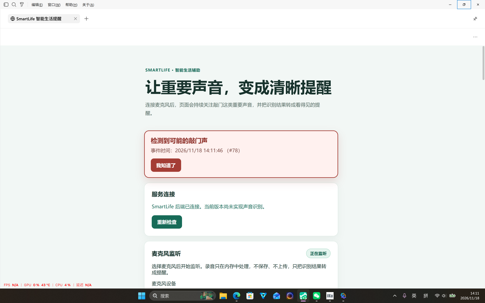
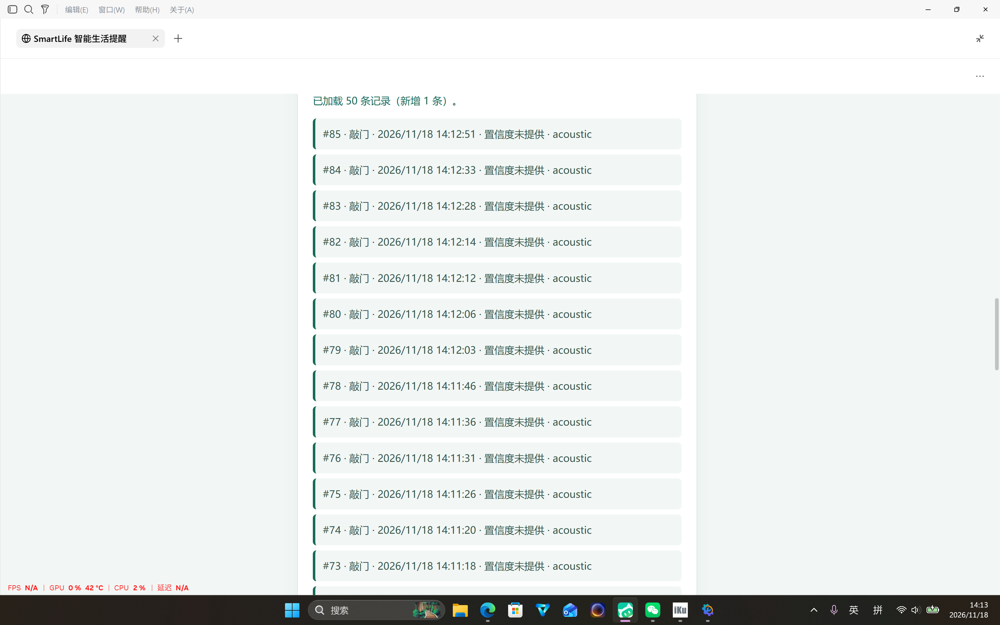

# SmartLife

## 1. 项目简介

SmartLife 是面向听障人士的智能生活声音提醒辅助系统。

它要解决的是一个很具体的生活问题：**门被敲了，但听不见**。听障人士无法通过听觉感知门外的访客，
容易漏接；而市面上的闪光门铃、震动门铃需要额外硬件，有采购和安装门槛。SmartLife 选择用**电脑麦克风 +
声音识别**这条路径：不需要任何额外硬件，用已有的笔记本电脑麦克风和浏览器，就能把"门外有人敲门"
变成屏幕上看得见的提醒。

选择这条技术路线，也是因为它可扩展：一旦"采集 → 识别 → 提醒"这条链路跑通，理论上可以逐步加入更多
需要被"听见"的声音，而不必为每种声音换一套硬件。

---

## 2. 📖 本文档可以看到什么

- **项目简介** —— SmartLife 要解决什么问题，以及为什么采用电脑麦克风 + 声音识别的方式。
- **第一版正式功能范围** —— 当前版本真正实现了什么，以及哪些声音暂时没有纳入正式功能。
- **项目分工** —— 项目负责人、ChatGPT、VS Code + Codex、WorkBuddy 分别承担了什么工作。
- **制作过程** —— 从基础网页和数据库，到 YAMNet 声音识别、真实麦克风接入，再到最终真实验收的完整过程。
- **技术实现** —— 从麦克风采集、音频处理、YAMNet 识别，到事件写入数据库和网页提醒的完整技术链路。
- **测试与验收** —— 自动化测试、真实麦克风测试、真实敲门测试，以及最终验收结果。
- **30 次真实敲门专项测试结果** —— 连续 30 次真实敲击中 23 次成功触发网页提醒、7 次未触发，
  触发成功率约 **76%**，并附现场界面截图作为证据（详见 7.4 节）。
- **最终成果** —— 当前项目已经达到什么程度，实际运行效果如何。
- **当前不足与已知问题** —— 当前版本仍存在的问题、使用限制，以及后续可以继续改进的方向。
- **项目文件说明** —— GitHub 仓库中各主要目录和文件分别用于什么。
- **运行方式** —— 如果需要在本地复现项目，可以从这里了解启动环境和基本运行方法。

> **简单来说：** 这个 README 不只是介绍代码，也记录了 SmartLife 从想法、开发、测试到真实验收的完整过程。

---

## 3. 👥 项目分工

| 角色 | 承担的工作 |
|---|---|
| 项目负责人（本人） | 确定项目方向与第一版功能范围；提出需求；决定关键参数与技术取舍；提供真实录音；进行真实敲门、浏览器等现场测试；审核各阶段结果并完成最终验收 |
| WorkBuddy（AI） | 负责后续阶段的代码实施与修改、自动化测试、环境排障、数据测量与诊断、验收测试、项目整理及 GitHub 操作 |
| VS Code + Codex（AI 开发工具） | 主要负责项目初期及开发过程中的代码编写、文件创建与修改、功能实现、Bug 修复、部分本地测试与环境操作；作为主要开发环境和代码执行工具 |
| ChatGPT（AI） | 负责整体技术方案设计、架构规划、阶段任务拆解、技术路线判断、测试结果分析与开发过程指导 |

---

## 4. 🎯 项目目标 / 第一版正式功能范围

第一版聚焦一条完整链路，把它做实：

> 电脑麦克风采集 → 敲门声音识别 → 网页弹出提醒 → 事件写入历史

**第一版只正式支持"敲门"这一种声音。** 门铃、水壶、警报等类别虽然存在于数据库分类和离线评估中，
但**尚未纳入正式功能**：门铃的离线方案已验证（4 段真实录音中 3 段可识别），但真实现场受输入电平限制
（实测差约 10 dB），因此没有接入。

因此，当前版本**不宣称**支持门铃、不宣称支持多设备、不宣称多用户，也不宣称通用场景下的识别准确率。
目前唯一可以对外引用的实测数字，是本机现场 **30 次真实敲门**专项测试的触发成功率（约 **76%**，见 7.4 节）。

---

## 5. 🛠 制作过程

项目按"先打通数据链路，再逐层引入识别"的顺序推进，每个阶段都有可运行的产物和对应的自动化测试。

| 阶段 | 主要工作 | 结果 |
|---|---|---|
| 一、基础框架 | 搭建 FastAPI 服务、SQLite 两张表（事件、提醒设置）、网页界面；实现模拟事件、历史查询、提醒开关 | 数据链路先跑通，事件来源标记为 `simulated`，便于后续区分真实识别结果 |
| 二、识别环境与素材评估 | 建立独立 Python 环境并部署 YAMNet（521 类通用音频分类模型）；收集 12 段真实声音做批量评估 | 发现两个关键事实：整段取平均会严重稀释事件，必须逐帧判定；字面的 `Doorbell` 类几乎不响应真实门铃，必须用"钟声族"替代 |
| 三、离线方案定稿 | 确定"类别组取最大值 + 3 帧滑动平均 + 阈值 0.45"的判定规则 | 离线复算门铃 3/4、敲门 3/4，对照样本无误触发 |
| 四、流式识别 | 把连续音频流转成与离线一致的分析帧：48k→16k 重采样、定长切窗、启动预热 | 窗口对齐与分块方式严格自测，分块大小对结果影响为 0 |
| 五、后端监听接口 | 新增 `devices / start / stop / status` 四个接口，服务内以后台线程执行识别 | 网页可以控制启停并读取状态；无识别依赖的环境也能启动服务（模型懒加载） |
| 六、真实麦克风采集 | 接入 `sounddevice` 打开真实麦克风；处理 Windows 音频线程的初始化约束 | 成功开流；同时发现本机某个音频端点为"聋端点"，只有 MME 端点能收到声音 |
| 七、首次真实验收与诊断 | 真实按门铃、真实敲门，两次均为 0 事件；逐层测量电平与逐帧分数定位原因 | 查出两条不同病因：门铃是**输入电平不足**，敲门是**音色不匹配**，都不是代码缺陷 |
| 八、敲门事件桥接 | 把识别到的敲击"候选簇"转为数据库事件；加入去重、时间锚点、落库开关 | 去重键结合会话与检测器状态，避免重启后撞号；写库失败不影响识别线程 |
| 九、网页功能 | 设备选择、五态状态显示、状态与事件轮询、顶部敲门横幅 | 页面加载读设备、开始后进入监听、新事件只提醒一次、刷新不重复弹 |
| 十、真实麦克风最终验收 | 启用落库、真实麦克风、真实敲门、浏览器实测 | **端到端链路首次全部跑通**，真实敲门成功写入事件并在网页弹出提醒 |
| 十一、项目整理与上传 | 整理代码与测试脚本，排除数据库、真实录音、虚拟环境、备份等 | 以 `SmartLife/` 目录并入团队仓库，未改动仓库内其他项目 |

**其中第七阶段值得单独说明**，因为它是整个项目最有价值的一段：第一次真实验收时，门铃和敲门都是
0 事件。问题不在于"模型不行"，而在于两件不同的事——

- 门铃的真实问题是**音量不够**。YAMNet 对绝对电平很敏感，阈值 0.45 对应的交叉点在约 −17 dBFS，
  而现场只有 −27 dBFS，差了 10 dB。
- 敲门的真实问题是**音色不匹配**。电平完全够（−15.7 dBFS），但分数只有 0.0006，与音量无关。

把这两种失败区分开之后，才知道该修什么、不该修什么。

---

## 6. ⚙️ 技术实现

以下名称均为实际代码中的实现，不是示意图。

### 6.1 整体链路

```text
真实麦克风（MME 端点，48000 Hz / 单声道 / float32 / 每块 960 样本）
  ↓  sounddevice.InputStream            app/recognition.py
  ↓  回调只做拷贝入队（有界队列，约 1 秒缓冲）
  ↓  后台识别线程取出
  ↓  48k → 16k 重采样：201 抽头 FIR 低通 + 3:1 抽取   yamnet_prototype/yamnet_stream.py
  ↓  定长切窗：15600 样本 / 步长 7680 样本
  ↓  启动预热：丢弃前 2 帧（首次出结果约 2.9 秒）
  ↓  YAMNet（SavedModel，输出 521 类分数）
  ↓  类别组取最大值：knock = max(Knock, Door, Hammer)
  ↓  3 帧滑动平均，阈值 0.45
  ↓  帧判定：冷却 + 组间互斥，输出敲击候选簇
  ↓  事件桥接：按（会话，检测器状态，簇号）去重    app/recognition.py
  ↓  SQLite 写入：sound_events 表                  app/database.py
  ↓  FastAPI：GET /api/events
  ↓  网页每 2 秒轮询，仅对新增的 knock / acoustic 事件提醒
  ↓  顶部横幅「检测到可能的敲门声」+ 事件时间        static/js/app.js
```

### 6.2 采集层

麦克风由 `sounddevice` 打开，固定为 48000 Hz、单声道、float32、每块 960 样本（20 ms）。回调函数只做
一件事：把音频块拷贝进有界队列（约 1 秒缓冲），不在回调里做任何计算，避免阻塞音频线程。真正的
重采样、切窗和推理都在后台线程完成。

项目初期踩过一个与识别无关的坑：Windows 的音频输入流必须在**它自己所在的线程**里初始化，否则会报
PortAudio 错误。这个问题让开流失败过一次，与模型无关。

### 6.3 音频处理层

YAMNet 只接受 16 kHz、长度固定的输入，而麦克风给的是连续不断的 48 kHz 流，必须自己转换：

1. **重采样 48k → 16k**：用 201 抽头 FIR 低通滤波器 + 3:1 抽取。这里不能用"逐块独立重采样"，
   那样会在块边界产生咔嗒声，实测偏差足以翻转判定。
2. **定长切窗**：窗口 15600 样本、步长 7680 样本。这个长度不是随便定的——YAMNet 一帧需要 96 个
   频谱帧，窗口偏短会被补零，分数偏差会大到改变结论。
3. **启动预热**：丢弃前 2 帧，因为刚开流时的缓冲区是不完整的。

### 6.4 识别层

YAMNet 是一个通用音频分类模型，输出 521 个类别的分数。项目没有训练新模型，而是用"类别组"的方式
借用它已有的类别：

| 声音 | 类别组（取组内最大值） |
|---|---|
| 敲门 | `Knock`、`Door`、`Hammer` |
| 门铃（离线评估用，未接入正式链路） | `Doorbell`、`Ding-dong`、`Chime`、`Bell`、`Wind chime` |

判定规则是：取组内最大分 → 对最近 3 帧做滑动平均（避免单帧抖动）→ 超过阈值 0.45 视为候选 →
加冷却时间与组间互斥，避免一次敲击被反复触发。

### 6.5 事件层

识别到的敲击"候选簇"需要变成持久化的事件，这一步有几个容易出错的地方：

- **去重键**是（会话号，检测器状态，簇号）三元组。只用簇号会在检测器重启后撞号，导致事件丢失。
- **时间戳以会话开始时刻为锚点**，加上该帧在流中的偏移，而不是"写库时刻"，保证记录的是事件真正
  发生的时间。
- **写库失败不会影响识别线程**：失败只累计错误计数，线程继续运行；只有写成功的簇才进入已完成集合，
  失败的可以在下一轮重试，但不会重复写。

### 6.6 服务与接口层

FastAPI 提供两层接口：

- **监听控制**：`GET /api/listen/devices`（输入设备列表与推荐设备）、`POST /api/listen/start`
  （请求体包含显式设备索引）、`POST /api/listen/stop`（幂等）、`GET /api/listen/status`
  （状态、设备信息、帧统计、麦克风电平、落库计数）。
- **事件与设置**：`GET /api/events`（按时间倒序，支持分页）、`POST /api/events/simulate`
  （模拟事件）、`GET /api/settings/alerts`、`PATCH /api/settings/alerts/{event_type}`、
  `GET /api/health`、`POST /api/test-alert`。

开始监听是**异步**的：接口立刻返回，状态先处于"启动中"，模型加载完成后才转为"正在监听"。
这样网页可以立即响应，也避免了把"启动中"谎报成"正在监听"。

### 6.7 网页层

页面加载时读取设备列表，按"MME 优先"排序并默认选中，开始监听时**显式传入设备索引**——因为服务端默认
会选评分最高的端点，而本机那个端点实际上收不到声音，不能依赖它的默认值。

进入监听后，页面每 1.5 秒查询一次状态、每 2 秒查询一次事件。事件采用**基线去重**：首次加载历史时
记录最大事件 ID 作为基线，之后只对"ID 大于基线 + 来源为 acoustic + 类型为 knock"的新事件弹横幅，
同一 ID 只弹一次。这样刷新页面不会把旧事件重新弹一遍。

---

## 7. 🧪 测试与验收

### 7.1 自动化测试

每个开发阶段都配有可直接复跑的测试脚本，位于 `tools/` 与 `yamnet_prototype/` 下的 `*_selftest.py`：

| 测试脚本 | 覆盖内容 |
|---|---|
| `yamnet_stream_selftest.py` / `acoustic_features_selftest.py` | 重采样、切窗、窗口对齐、分块无关性 |
| `listen_api_smoke.py` | 监听接口的请求、响应与错误语义 |
| `listen_stage3_mic_smoke.py` / `listen_stage3_real_mic.py` | 采集链路、状态流转、电平与逐帧分数可观测性 |
| `knock_bridge_smoke.py` | 敲门事件写入、去重键、时间锚点、落库开关三态 |
| `web_listen_smoke.js` / `web_listen_contract.py` | 前端状态映射、基线去重、提醒开关；真实后端契约 |

累计**数百项断言全部 PASS、0 FAIL**。测试全程使用临时数据库与假麦克风，不污染正式数据。

### 7.2 真实麦克风测试

在 Windows 本机、真实运行环境下完成，不使用任何模拟事件：

| 项目 | 实测结果 |
|---|---|
| 设备 | MME「麦克风阵列（英特尔® 智音技术）」，成功打开 |
| 采样参数 | 48000 Hz、单声道、float32、每块 960 样本（20 ms） |
| 采集稳定性 | 采样位置稳定推进，掉块 0、溢出 0、重同步 0 |
| 状态流转 | 开始请求先处于"启动中"，约 3 秒后进入"正在监听"，未把启动中谎报为正在监听 |

### 7.3 真实敲门测试与最终验收

| 项目 | 实测结果 |
|---|---|
| 真实敲门识别 | **成功。两轮共写入 11 条真实敲门事件** |
| 事件写入 | 全部为 `event_type=knock`、`source=acoustic`，`persist_errors=0`（写入失败计数为 0） |
| 接口可查 | `/api/events` 可读取全部新事件，时间为 UTC，与本地敲门时刻吻合 |
| 网页提醒 | 用户在浏览器实测确认出现「检测到可能的敲门声」横幅 |
| 数据库最终状态 | 16 条事件、4 条提醒设置未变、完整性检查通过；原有 5 条模拟事件完整保留 |

### 7.4 30 次真实敲门专项测试

在完成最终验收后，又做了一轮**连续 30 次真实敲门**的专项测试：环境、麦克风、阈值与程序都不改动，
由项目负责人按正常生活节奏敲门，逐次现场记录是否弹出网页提醒。

| 测试项 | 结果 |
|---|---|
| 测试环境 | 本机 Windows、MME「麦克风阵列（英特尔® 智音技术）」、48000 Hz / 单声道 |
| 测试次数 | 30 次真实敲门 |
| 成功触发（网页弹出「检测到可能的敲门声」并写入数据库） | **23 次** |
| 未触发（无提醒、无新事件） | **7 次** |
| 触发成功率 | **约 76%（23 / 30 ≈ 76.7%）** |
| 论文/汇报口径 | 本机现场条件下的**敲门提醒触发成功率约 76%** |

**测试证据（现场界面截图）：**

网页弹出敲门提醒（事件 #78，2026/11/18 14:11:46），下方麦克风监听状态为"正在监听"：



同一轮测试中的历史记录列表（已加载 50 条记录、新增 1 条，事件 #73–#85 连续写入，均为 `acoustic` 来源）：



**关于 7 次未触发：** 未触发的 7 次没有产生任何提醒和任何新事件，属于"漏检"而非"误报"。
现场观察这几次多发生在敲击力度明显偏轻、或敲击点离麦克风较远的时候，与第 9 节第 1 条描述的"识别结果对
敲击方式敏感"一致；但这 7 次没有做逐次的声压级/分数记录，因此**不对未触发原因下定量结论**。

**这组数字该怎么理解：** 76% 是**同一台电脑、同一个房间、同一个人敲击**条件下的实测触发成功率，
说明链路本身在真实环境中可用；它**不是**跨房间、跨设备、跨敲击习惯的通用准确率，
不能直接外推为"识别准确率 76%"。

---

## 8. 📊 最终成果

当前版本已经能完整跑通一条真实可用的链路：

**真实麦克风采集（成功）→ YAMNet 敲门识别（成功）→ 事件写入数据库（成功）→ `/api/events` 可查
（成功）→ 网页弹出提醒（成功）**

具体地说，打开网页点"开始监听"后，约 3 秒进入"正在监听"；有人敲门时，页面顶部会弹出
「检测到可能的敲门声」并显示事件时间，事件同时写入本机数据库，刷新页面后仍能在历史记录里看到。

在连续 30 次真实敲门的专项测试中，23 次成功弹出提醒并写入数据库、7 次未触发，**触发成功率约 76%**
（见 7.4 节，含现场界面截图证据）。

工程层面，项目具备：

- 可复跑的自动化测试（每阶段一套，累计数百项断言全通过）
- 明确的数据库完整性保障（每次验收前后校验，`integrity_check` 始终通过）
- 真实录音、数据库、虚拟环境均不进入版本库，**不保存也不上传任何录音**

---

## 9. ⚠️ 当前不足与已知问题

以下均为已确认存在的真实问题，按影响程度排列：

1. **识别结果对敲击方式敏感。** 同一环境下，敲击力度、接触面、与麦克风的距离都会明显影响分数：
   先前的现场敲门得分极低（未触发），而最终验收时同类真实敲门可以越过阈值。识别链路可用，
   但尚未做跨场景的稳定性标定。目前只有一轮 30 次现场专项测试的触发成功率（约 76%，见 7.4 节），
   样本量小、条件单一，**仍不足以作为通用准确率**。
2. **页面刷新后不会继续提醒。** 刷新页面会正确显示"正在监听"，但轮询是由"点击开始监听"启动的，
   刷新后不会自动恢复。规避办法：停止监听后重新开始。
3. **门铃未纳入正式功能。** 离线方案已验证，但真实场景输入电平不足，未接入正式链路。
4. **事件数与敲击次数不完全对应。** 验收中出现过间隔 2~3 秒的成对事件，可能是单次敲击产生多个候选簇，
   也可能是环境声误报，尚未定性。
5. **事件不记录置信度。** 分数未做标定，因此不冠以"置信度"之名，页面上也不显示可信度。
6. **仅支持本机使用。** 服务绑定本机地址，手机无法访问；且当前没有任何访问鉴权，
   在开放到局域网之前必须先加访问口令。
7. **单进程单会话。** 一个服务进程同时只能运行一个监听会话。

后续可改进的方向（尚未开始）：输入增益归一化以改善低电平场景、补充现场样本重新标定敲门识别、
增加访问鉴权以支持局域网/手机访问、扩展门铃等更多声音。

---

## 10. 📁 项目文件说明

```text
SmartLife/
├── app/                          # 后端服务
│   ├── main.py                   # FastAPI 应用、事件与设置接口
│   ├── listen_api.py             # 监听控制接口（devices / start / stop / status）
│   ├── listen_schemas.py         # 监听相关的数据结构
│   ├── recognition.py            # 监听服务、麦克风采集、识别线程与敲门事件桥接
│   ├── audio_devices.py          # 音频设备枚举与筛选
│   ├── database.py               # SQLite 初始化与数据访问
│   └── schemas.py                # 事件与提醒设置的数据结构
├── static/                       # 网页前端
│   ├── index.html
│   ├── js/app.js                 # 监听控制、状态轮询、敲门提醒
│   └── css/styles.css
├── tools/                        # 自动化测试脚本
├── reports/                      # 测试报告与测试证据
│   └── evidence/                 # 30 次敲门专项测试的现场界面截图
├── yamnet_prototype/             # YAMNet 识别原型
│   ├── yamnet_recognizer.py      # 模型加载与帧级评分
│   ├── yamnet_stream.py          # 流式切窗、重采样、预热
│   ├── models/yamnet/            # YAMNet SavedModel
│   ├── reports/                  # 离线评估与诊断报告
│   └── samples/                  # 合成自测音频（非真实录音）
├── .gitignore
├── README.md
└── requirements.txt
```

| 目录 / 文件 | 用途 |
|---|---|
| `app/` | 后端服务本体：接口、监听服务、采集、识别桥接、数据库访问 |
| `static/` | 网页前端：页面、样式、交互逻辑 |
| `tools/` | 各阶段自动化测试脚本，可直接复跑 |
| `reports/` | 测试报告与测试证据：`evidence/` 下为 30 次敲门专项测试的现场界面截图 |
| `yamnet_prototype/` | 识别原型：模型加载、流式处理、离线评估脚本与报告 |
| `yamnet_prototype/models/yamnet/` | YAMNet 模型文件（运行识别所必需） |
| `yamnet_prototype/reports/` | 离线评估、帧级诊断、策略设计等报告 |
| `yamnet_prototype/samples/` | 合成自测音频，用于验证重采样与切窗，**不是真实录音** |
| `requirements.txt` | 基础服务依赖（FastAPI / uvicorn / Pydantic） |

以下内容**不在版本库中**：

| 排除项 | 原因 |
|---|---|
| `data/`（含 `smartlife.db`） | 本机数据库，含用户历史事件与设置 |
| `yamnet_prototype/recordings/`、`recordings_negative/` | 现场采集的真实录音，涉及隐私 |
| `.venv/`、`yamnet_prototype/.venv/` | Python 虚拟环境，可由依赖清单重建 |
| `backup/`、`__pycache__/`、`*.pyc`、`*.log` | 备份、缓存与本地日志 |
| `yamnet_prototype/models/*.tar.gz` | 模型下载归档，与已解包模型重复 |

---

## 11. ▶️ 运行方式

### 11.1 环境要求

**运行识别栈必须使用 `yamnet_prototype\.venv`**：项目根目录的 `.venv` 只装了 FastAPI/uvicorn，
没有 numpy、sounddevice、tensorflow，用它启动会得到
`/api/listen/devices → available=false（No module named 'sounddevice'）`。

Python 3.11，识别依赖版本：tensorflow 2.15.1 / tensorflow-intel 2.15.1 / tensorflow-hub 0.16.1 /
tf-keras 2.15.1 / numpy 1.26.4 / sounddevice 0.5.6。

单独验证音频依赖是否齐备：

```powershell
.\yamnet_prototype\.venv\Scripts\python.exe -c "import numpy, sounddevice, tensorflow, tensorflow_hub; print('ok')"
```

### 11.2 启动服务（Windows PowerShell）

正式运行（启用敲门事件落库）：

```powershell
Set-Location D:\SmartLife
$env:SMARTLIFE_ENABLE_KNOCK_PERSIST = "1"
.\yamnet_prototype\.venv\Scripts\python.exe -m uvicorn app.main:app --host 127.0.0.1 --port 8765
```

要点：

- **环境变量必须在启动进程之前设置。** `SMARTLIFE_ENABLE_KNOCK_PERSIST` 在
  `app/recognition.py` 导入时读取一次，进程启动后再设置不会生效，必须重启进程。
  不设置或设为 `0` 时，敲门事件不写库（页面会显示"敲门事件落库未启用"）。
- **正式运行建议不要加 `--reload`。** reload 会派生工作子进程并反复重载模型，启动更慢、
  状态更不稳定，只适合开发调试。
- 需要在没有识别依赖的环境里只调接口时，才用根目录 `.venv`；此时不要打开麦克风监听。

根目录 `.venv` 的创建与安装（仅用于无识别的接口调试）：

```powershell
py -3.11 -m venv .venv
.\.venv\Scripts\python.exe -m pip install -r requirements.txt
```

SQLite 驱动是 Python 标准库的一部分，不需要额外安装。

### 11.3 使用流程

1. 启动后端服务（上面的命令），保持该窗口不要关闭。
2. 浏览器打开 <http://127.0.0.1:8765/>，交互式 API 文档位于 <http://127.0.0.1:8765/docs>。
3. 确认设备下拉默认选中 MME 麦克风，且页面显示"敲门事件落库已启用"。
4. 点击「开始监听」，等待状态徽标由"启动中"变为"正在监听"。
5. 有人敲门时，页面顶部弹出「检测到可能的敲门声」及事件时间。
6. 使用完毕点击「停止监听」，再关闭后端服务窗口。

### 11.4 数据与隐私

- 系统**不保存、不上传任何录音**。音频只在内存中经过重采样、切窗和模型推理，随即丢弃。
- 数据库仅记录事件类型、发生时间与来源，字段中不含音频内容。
- 首次启动会自动创建 `data/smartlife.db` 和默认提醒设置；删除该文件会同时丢失历史记录与设置。
- 当前服务仅监听本机地址，未提供访问鉴权；在开放到局域网之前需先补充访问控制。
