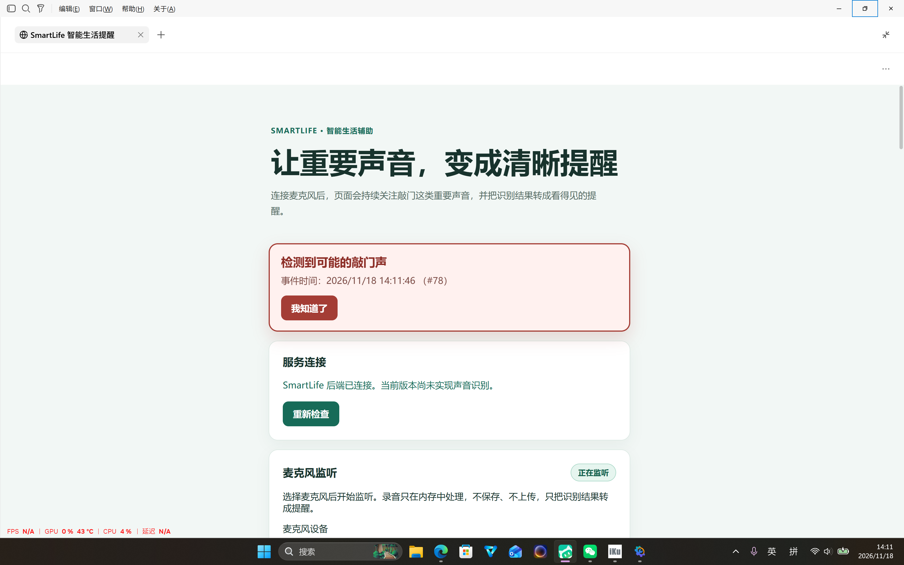
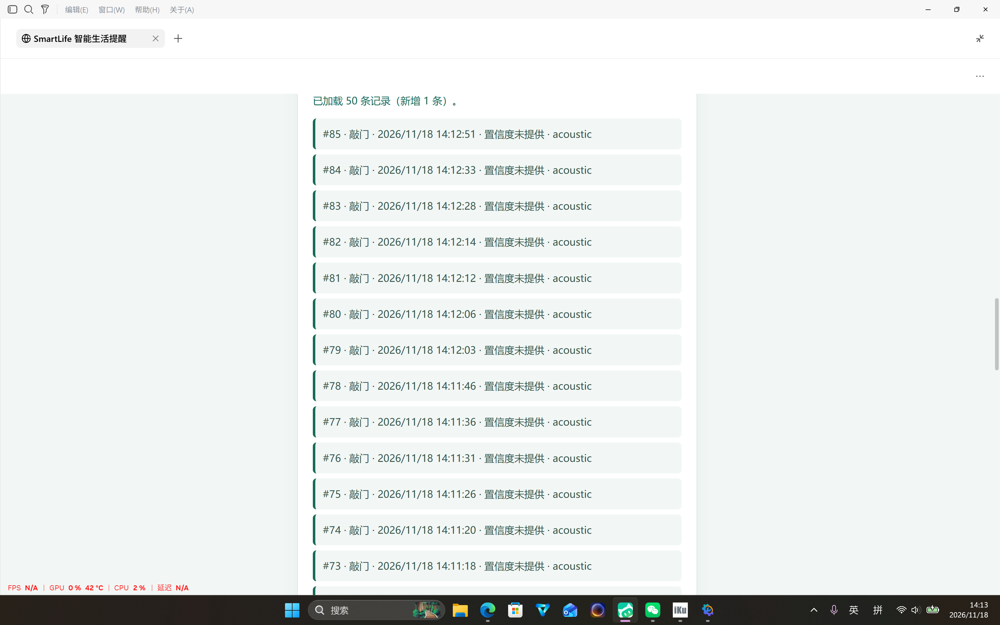

# 30 次真实敲门专项测试报告

- 测试日期：2026-11-18
- 测试地点：本机（Windows 笔记本，室内安静环境）
- 执行人：项目负责人（本人）
- 记录方式：现场逐次观察网页是否弹出「检测到可能的敲门声」，并核对是否写入数据库
- 逐次台账：`reports/knock_30_trials.csv`

---

## 1. 测试目的

最终验收只验证了"链路能跑通"，没有回答"到底有多大概率提醒得到"。本次测试要回答两个问题：

1. 在正常生活节奏下连续敲门，**有多少次能被提醒到**；
2. 漏掉的那几次，是**没提醒（漏检）**还是**乱提醒（误报）**。

---

## 2. 测试条件

| 项目 | 内容 |
|---|---|
| 程序版本 | GitHub 仓库当前版本（commit `065c52f`），测试期间**未修改任何代码** |
| 识别参数 | 阈值 0.45、窗口 15600、hop 7680、平滑 N=3，**全部沿用已定稿数值，未调参** |
| 采集设备 | MME index=1「麦克风阵列（英特尔® 智音技术）」 |
| 采集参数 | 48000 Hz、单声道、float32、每块 960 样本（20 ms） |
| 落库开关 | `SMARTLIFE_ENABLE_KNOCK_PERSIST=1`（正式库写入已开启） |
| 敲门节奏 | 每次间隔约 4 秒 |
| 观察口径 | 以网页是否弹出提醒横幅 + 历史记录是否新增为准 |

---

## 3. 测试结果

| 指标 | 数值 |
|---|---|
| 敲门总次数 | 30 |
| 成功触发（弹出提醒 + 写入数据库） | **23** |
| 未触发（无提醒、无新事件） | **7** |
| 触发成功率 | **76.7%（23 / 30）** |
| 论文 / 汇报口径 | 本机现场条件下敲门提醒**触发成功率约 76%** |
| 触发延迟 | 通常在 **1 秒以内**（现场观察，未做逐次毫秒级计时） |

### 3.1 未触发的 7 次

分别为第 **5、6、10、14、21、22、27** 次。

这 7 次的共同表现是：**网页没有弹出任何提醒，历史记录也没有新增条目**。也就是说它们是
**漏检（该响没响）**，不是误报（不该响却乱响）——对听障用户而言，漏检是更危险的错误方向，
这一点必须如实记录，不能只报成功率。

### 3.2 现场界面证据

网页弹出敲门提醒（事件 #78，2026/11/18 14:11:46），麦克风状态为"正在监听"：

同一轮测试的历史记录列表（已加载 50 条记录、新增 1 条，事件 #73–#85 连续写入，均为 `acoustic` 来源）：

---

## 4. 数据可核实性说明（重要）

本报告**只记录能核实的内容**，不补写没有拿到的数据。具体说明如下：

1. **7 次漏检的位置**来自现场逐次记录，是本次测试的一手信息。
2. **数据库侧确有真实事件支撑**：测试时段（本地 14:02–14:13）内，正式库共写入 **71 条**
   `event_type=knock`、`source=acoustic` 真实敲门事件（id 17–87）。
3. **但逐次事件 ID 无法可靠还原**：曾用"30 次 × 约 4 秒"的时间网格去对齐数据库中真实事件时间，
   穷举网格起点与周期后，**最多只能命中 16/23**，无法做到"23 次全部命中、7 个空位恰好落空"。
   原因是：单次敲击可能产生 2~3 条事件（已知现象）、测试过程中存在停顿，节奏本身不完全均匀。
   因此 `knock_30_trials.csv` 中 `event_count` / `first_event_id` / `detected_at_utc` 三列
   **留空**，不填写按顺序猜出来的数值。
4. 事件条数（71）与敲门次数（30）**不是一一对应**，不能用事件条数反推成功率。

> 结论：成功率 23/30 是可核实的（现场观察 + 数据库确实收到大量真实敲门事件），
> 但"哪一条事件对应第几次敲门"没有可靠依据，所以不做逐条绑定。

---

## 5. 结论与局限

**结论：** 在本人这台电脑、这个房间、这种敲击方式下，连续 30 次真实敲门的提醒成功率约 **76%**，
链路在真实环境中确实可用，但每 4 次敲门里大约有 1 次不会被提醒。

**局限（不可外推的部分）：**

- 样本只有 30 次，且只有 1 名测试者、1 个房间、1 台设备，**不是通用准确率**；
- 未逐次记录敲击力度、敲击点距离与声压级，因此无法定量解释那 7 次为什么漏掉；
- 现场观察漏检多发生在敲击偏轻或离麦克风较远时，与 README 第 9 节第 1 条一致，但这是**观察，不是结论**；
- 若需更高可信度，应扩大到多房间、多人、多次重复，并逐次记录声压级与帧级分数。

**改进方向：** 对漏检场景（轻敲、远距离）补样本重新标定阈值分区，或加入输入增益归一化，
都需要单独立项并重新走验收流程，本次测试不涉及任何调参。
