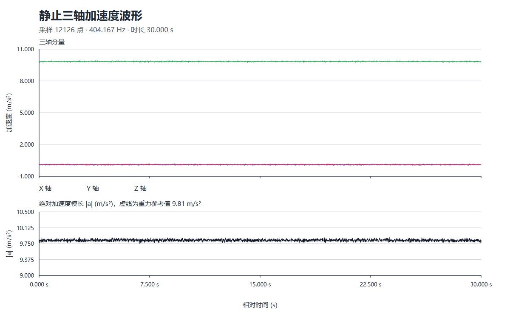
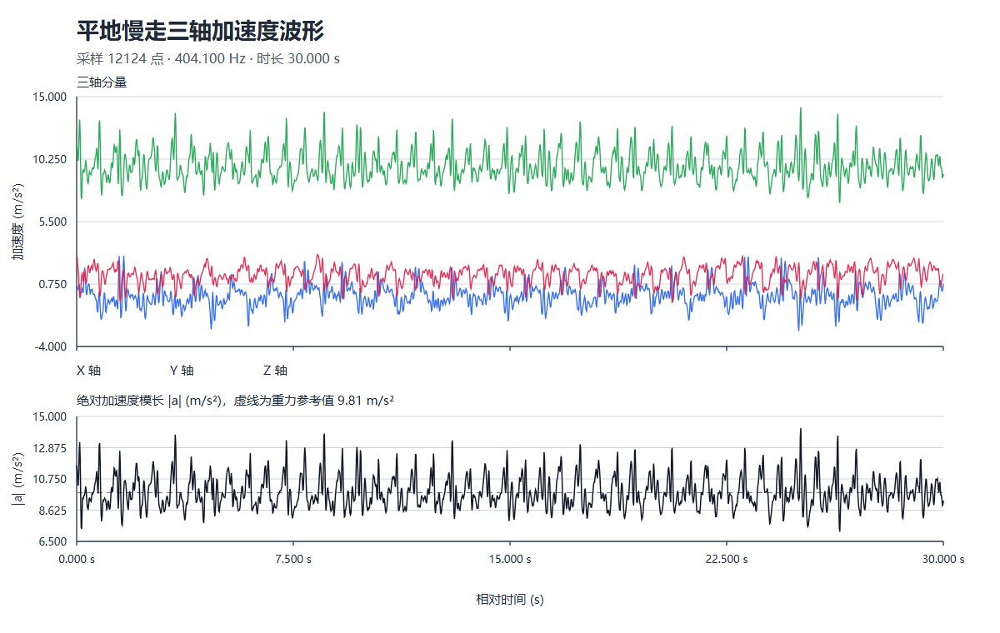
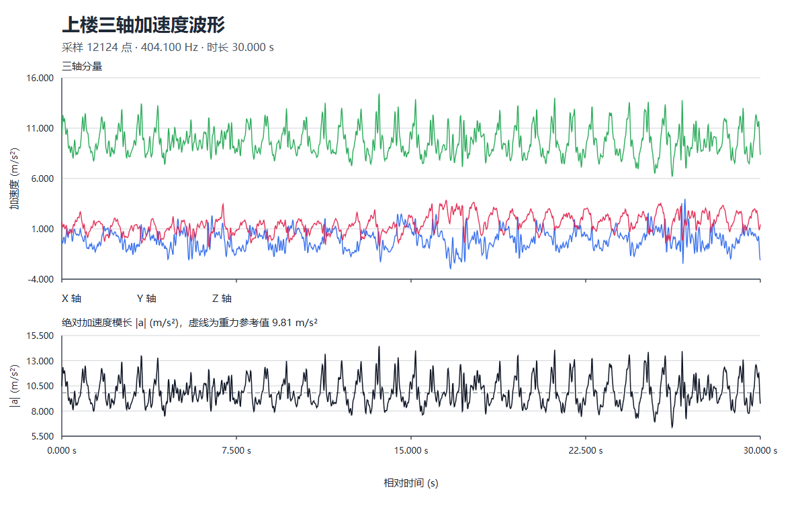
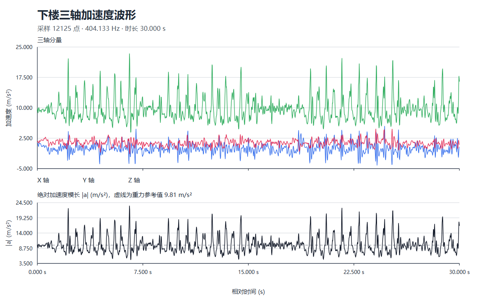
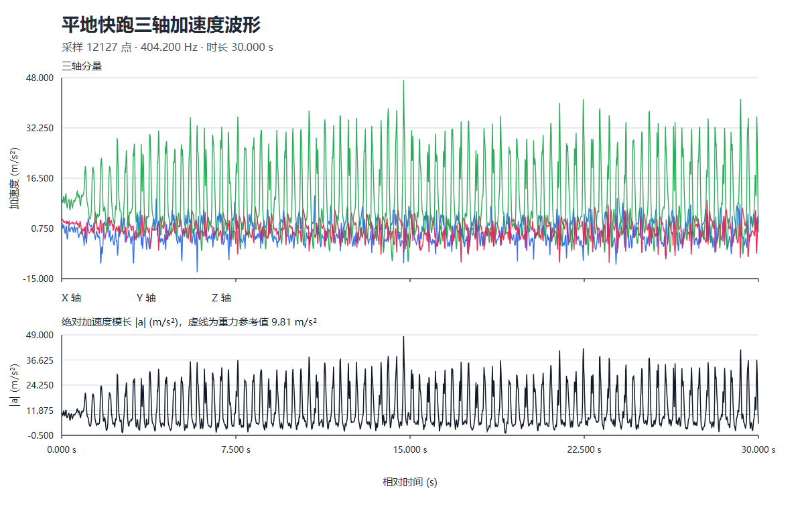

# 多姿态步态加速度特征采集与对比

本项目对静止、平地慢走、上楼、下楼和平地快跑五种状态的三轴加速度数据进行整理和初步对比。每份采样时长为 30 秒，包含原始 CSV、统计结果和波形图。

## 项目文件

| 内容 | 位置 | 说明 |
| --- | --- | --- |
| 原始采样 | [`数据/原始采样/`](数据/原始采样/) | 五种状态的 30 秒 CSV |
| 样本统计 | [`数据/样本统计.csv`](数据/样本统计.csv) | 样本数量、时长、采样频率和加速度特征 |
| 采样预览 | [`数据/采样数据表格预览.md`](数据/采样数据表格预览.md) | 每种状态前 5 条采样记录 |
| 波形图 | [`图表/步态波形图PNG/`](图表/步态波形图PNG/) | 可直接查看的五张 PNG 图 |
| 分析脚本 | [`脚本/生成可视化.mjs`](脚本/生成可视化.mjs) | 使用 Node.js 内置模块生成统计表和 SVG 源图 |

## 采样数据

CSV 保留 Phyphox 导出的表头和五列数据：时间、X/Y/Z 轴加速度，以及绝对加速度。每份数据从首个采样点开始截取 30 秒；为准确落在 30 秒边界，末尾增加一条线性插值记录，其余记录保持原样。

| 状态 | 采样点数 | 时长 | 采样频率 | 数据文件 |
| --- | ---: | ---: | ---: | --- |
| 静止 | 12,126 | 30.000 秒 | 404.167 Hz | [CSV](数据/原始采样/静止.csv) |
| 平地慢走 | 12,124 | 30.000 秒 | 404.100 Hz | [CSV](数据/原始采样/平地慢走.csv) |
| 上楼 | 12,124 | 30.000 秒 | 404.100 Hz | [CSV](数据/原始采样/上楼.csv) |
| 下楼 | 12,125 | 30.000 秒 | 404.133 Hz | [CSV](数据/原始采样/下楼.csv) |
| 平地快跑 | 12,127 | 30.000 秒 | 404.200 Hz | [CSV](数据/原始采样/平地快跑.csv) |

GitHub 对完整采样 CSV 不提供表格预览。可查看[采样记录预览](数据/采样数据表格预览.md)，或下载 CSV 后使用电子表格软件打开。

## 波形图

图表由 30 秒采样数据生成，展示 X/Y/Z 轴加速度及加速度模长。

### 静止



### 平地慢走



### 上楼



### 下楼



### 平地快跑



## 特征与初步规则

令三个轴向加速度为 `x`、`y`、`z`，其合加速度模长为：

```text
|a| = sqrt(x² + y² + z²)
```

使用约 1 秒非重叠窗口内 `|a|` 的标准差作为活动强度特征：

```text
S = std(|a|)
```

| 1 秒窗口特征 S | 初步判断 |
| --- | --- |
| `S < 0.15 m/s²` | 静止 |
| `0.15 ≤ S < 6.0 m/s²` | 活动态；慢走和上下楼需要结合其他特征区分 |
| `S ≥ 6.0 m/s²` | 倾向快跑，需结合连续窗口和周期性复核 |

五种状态的窗口 S 中位数及 P10–P90 范围如下：

| 状态 | 中位数 (`m/s²`) | P10–P90 (`m/s²`) |
| --- | ---: | ---: |
| 静止 | 0.023 | 0.021–0.025 |
| 平地慢走 | 1.047 | 0.808–1.274 |
| 上楼 | 1.256 | 0.847–1.621 |
| 下楼 | 2.991 | 1.015–3.634 |
| 平地快跑 | 9.446 | 7.204–10.014 |

## 使用限制

- 当前每种状态只有一段样本，阈值仅供本次采集条件下初步筛查，不代表通用分类性能。
- 慢走、上楼和下楼的特征范围有重叠，仅凭 `S` 不能可靠地区分。
- 手机型号、传感器设置、握持方式、朝向和佩戴位置都可能影响结果。
- 增加多次独立采集后，应使用训练集和留出验证集重新校准规则。

## 重新生成统计与源图

在仓库根目录运行：

```powershell
node .\实地测评\脚本\生成可视化.mjs
```

统计表写入 `实地测评/数据/样本统计.csv`；未提交的 SVG 源图写入 `实地测评/图表/源图/`。
