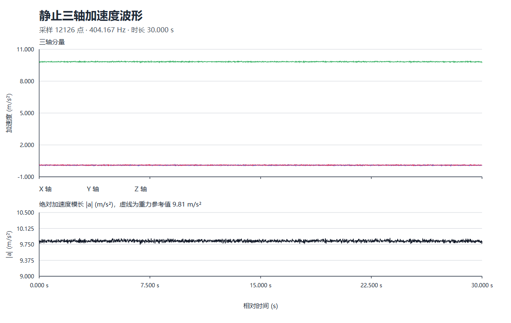
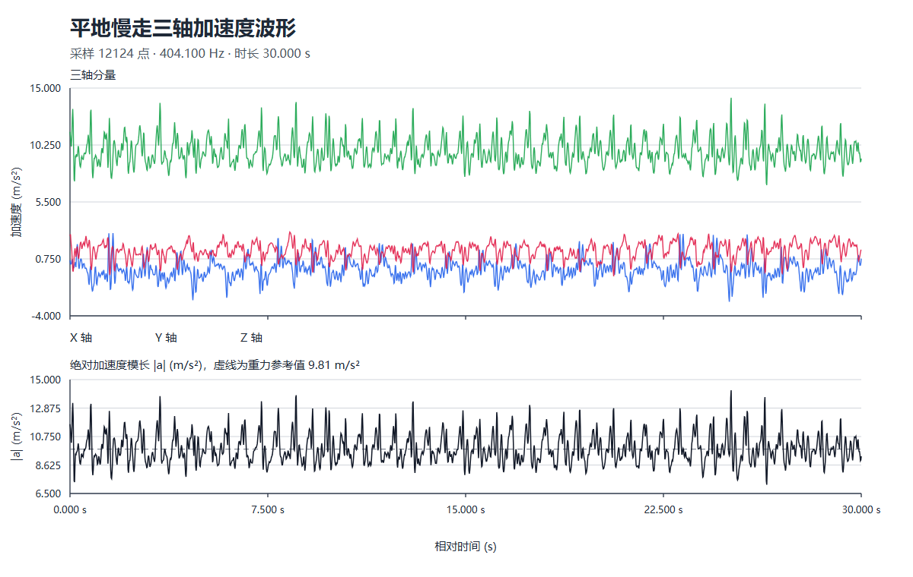
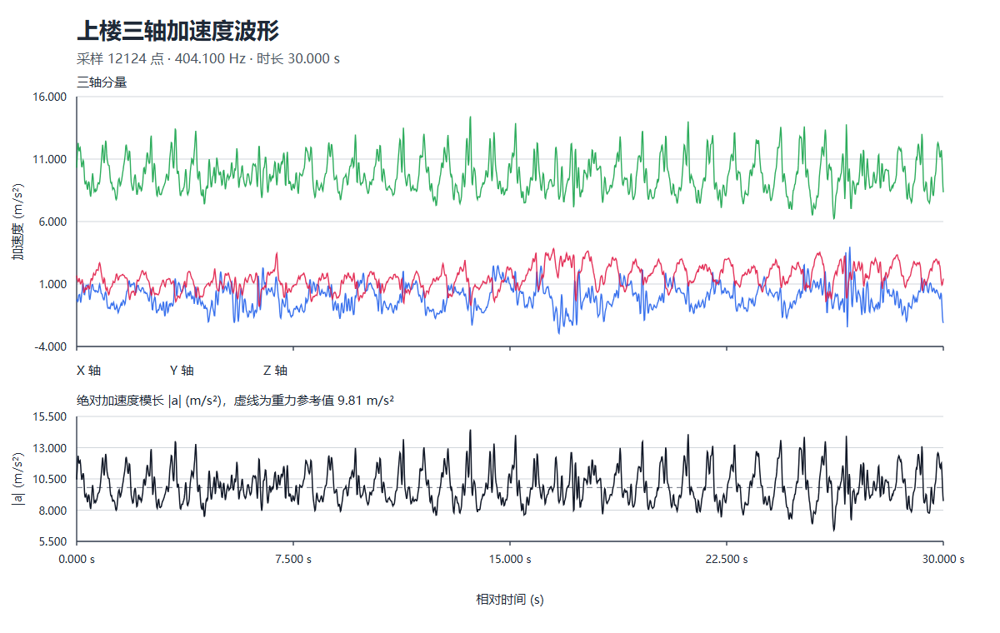
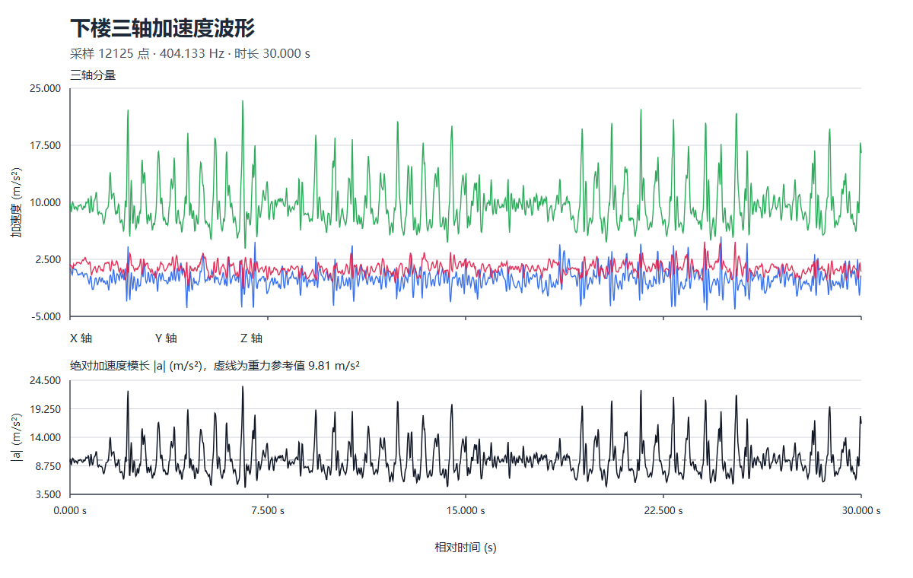
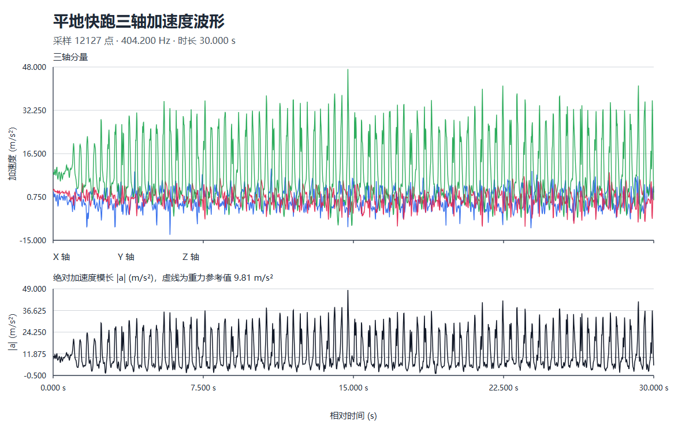

# 多姿态步态加速度特征采集与对比

本目录整理静止、平地慢走、上楼、下楼和平地快跑五种状态的三轴加速度样本，并提供波形图、统计结果和初步动作区分规则。

## 交付内容

| 文件或目录 | 说明 |
| --- | --- |
| [`静止.csv`](静止.csv)、[`平地慢走.csv`](平地慢走.csv)、[`上楼.csv`](上楼.csv)、[`下楼.csv`](下楼.csv)、[`平地快跑.csv`](平地快跑.csv) | 五种状态的完整原始采样 CSV，可下载用于 Excel 等工具分析 |
| `步态波形图PNG/` | 五种状态的 PNG 波形图，目录名说明了图片内容和格式 |
| [`样本统计.csv`](样本统计.csv) | 每种状态的采样点数、时长、采样率及加速度模长统计 |
| [`采样数据表格预览.md`](采样数据表格预览.md) | 每种状态的前 5 条采样记录，方便直接浏览 |
| [`生成可视化.mjs`](生成可视化.mjs) | 使用 Node.js 内置模块生成本地 SVG 源图和统计表，无需安装第三方依赖 |

## 波形图

### 静止



### 平地慢走



### 上楼



### 下楼



### 平地快跑



## 原始采样数据表

每份 CSV 都覆盖严格 30.000 秒；为精确落在 30 秒边界，末尾增加了一条线性插值记录。GitHub 对这些较大的 CSV 不显示表格预览；可以查看下方摘要表和[采样数据表格预览](采样数据表格预览.md)，也可以下载完整 CSV 到 Excel 等工具中查看。

| 状态 | 采样记录 | 时长 | 采样频率 | 完整 CSV |
| --- | ---: | ---: | ---: | --- |
| 静止 | 12,126 | 30.000 秒 | 404.167 Hz | [下载](静止.csv) |
| 平地慢走 | 12,124 | 30.000 秒 | 404.100 Hz | [下载](平地慢走.csv) |
| 上楼 | 12,124 | 30.000 秒 | 404.100 Hz | [下载](上楼.csv) |
| 下楼 | 12,125 | 30.000 秒 | 404.133 Hz | [下载](下楼.csv) |
| 平地快跑 | 12,127 | 30.000 秒 | 404.200 Hz | [下载](平地快跑.csv) |

## 采样概况

每份样本正好 30.000 秒，采样频率约 404 Hz。文件包含时间戳、X/Y/Z 轴加速度和绝对加速度。统计脚本以每段实际时间戳计算采样频率，并以约 1 秒非重叠窗口计算加速度模长标准差。为了准确覆盖 30 秒边界，各文件最后一行是对末尾采样间隔线性插值得到的记录，其余记录均为原始采样点。

## 特征定义

令三个轴向的加速度为 `x`、`y`、`z`，加速度模长为：

```text
|a| = sqrt(x² + y² + z²)
```

本次用于初步区分活动强度的窗口特征为：

```text
S = std(|a|)
```

其中 `std` 表示一个约 1 秒窗口内的标准差，单位为 `m/s²`。

## 样本结果

以下数值来自每种状态各一段样本；`P10`、`P90` 分别表示该类 1 秒窗口特征的第 10 和第 90 百分位数。

| 状态 | 窗口 S 中位数 (`m/s²`) | 窗口 S P10–P90 (`m/s²`) |
| --- | ---: | ---: |
| 静止 | 0.023 | 0.021–0.025 |
| 平地慢走 | 1.047 | 0.808–1.274 |
| 上楼 | 1.256 | 0.847–1.621 |
| 下楼 | 2.991 | 1.015–3.634 |
| 平地快跑 | 9.446 | 7.204–10.014 |

完整统计数据见 [`样本统计.csv`](样本统计.csv)。

## 初步阈值规则

| 约 1 秒窗口特征 S | 初步判断 |
| --- | --- |
| `S < 0.15 m/s²` | 静止 |
| `0.15 ≤ S < 6.0 m/s²` | 活动态；结合步频和方向特征区分慢走、上楼和下楼 |
| `S ≥ 6.0 m/s²` | 倾向快跑；结合连续窗口和周期性复核 |

选择 `6.0 m/s²` 作为初步快跑界限，是因为本次快跑样本的窗口 S P10 为 `7.204 m/s²`，其他四类样本中最高的 P90 为下楼的 `3.634 m/s²`。静止界限 `0.15 m/s²` 也高于本次静止样本 P90 `0.025 m/s²`。

## 适用范围与限制

- 阈值仅供当前采集条件下的初步筛查，不是经过独立样本验证的通用分类器。
- 慢走、上楼和下楼的窗口 S 范围有重叠，不能仅凭该特征可靠地区分。
- 区分步态还应结合步频、峰值、三轴方向特征和连续窗口结果。
- 手机型号、传感器设置、握持方式、朝向和佩戴位置可能影响结果。
- 当前每种状态只有一段样本。增加多次独立采集后，应使用训练集和留出验证集重新校准阈值，并报告分类表现。

## 重新生成图表和统计表

更新本地 SVG 源图和统计表，在本目录运行：

```powershell
node .\生成可视化.mjs
```

仓库不保留 SVG 文件；生成的本地 SVG 源图由 `.gitignore` 排除。采样数据更新后，还需同步更新 `步态波形图PNG/` 中对应的 PNG 图片预览，再检查 README 中的图片是否正常显示。
