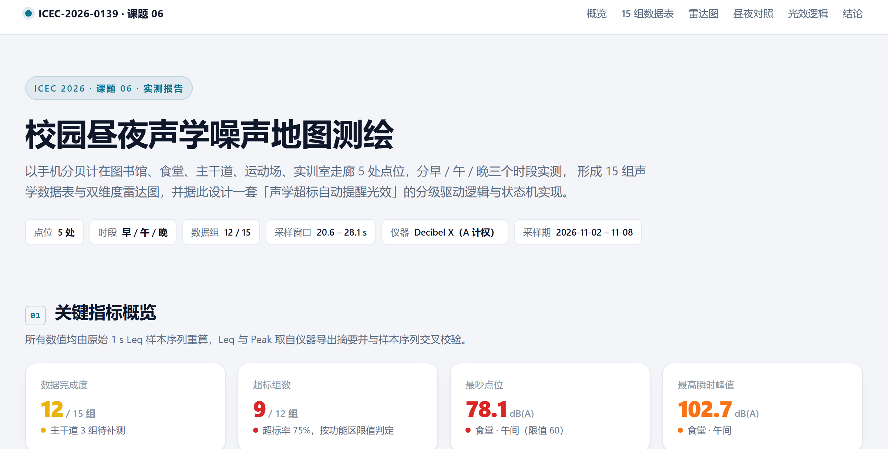
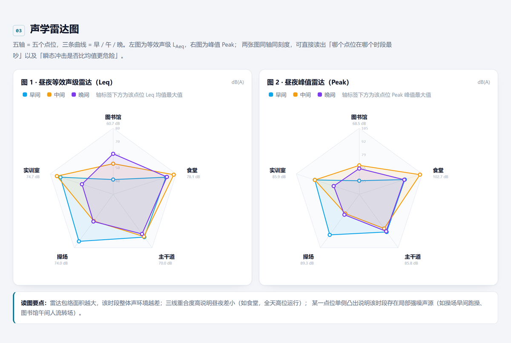
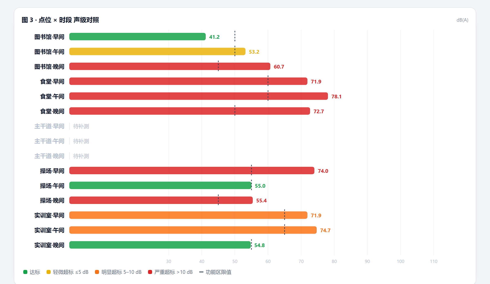
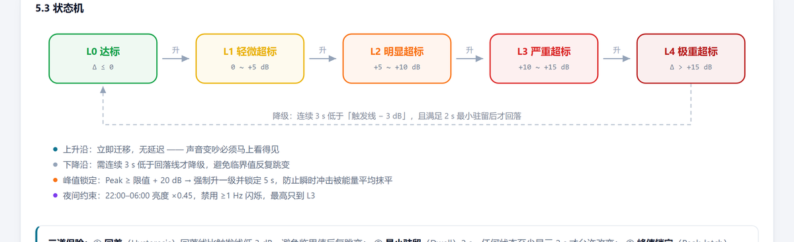
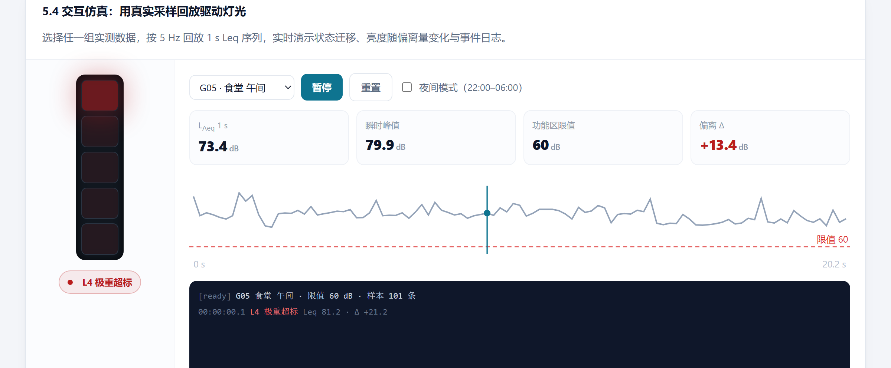

# 校园昼夜声学噪声地图测绘

[](https://github.com/m-1229/ICEC-2026-0139-BAIJUNMENG)
[](docs/light_logic.md)
[](#15-%E7%BB%84%E5%A3%B0%E5%AD%A6%E6%95%B0%E6%8D%AE%E8%A1%A8)
[](src/light_controller.test.js)

在校园 5 处点位（图书馆、食堂、主干道、运动场、实训室走廊）分早 / 午 / 晚三个时段实测噪声，
形成 15 组声学数据表、双维度雷达图，并设计一套可直接落地的「声学超标自动提醒光效」逻辑。

- **测量**：手机分贝计 Decibel X，A 计权，1 s 等效声级样本，单次窗口 20–28 s。
- **产出**：15 组数据表（CSV + 交互式 HTML）、Leq / Peak 双雷达图、五级光效状态机与参考实现。
- **状态**：15 / 15 组全部完成，1 625 条 1 s 样本；G09（主干道晚间）受风噪影响，已单列数据质量说明。



## 结论速览

- 15 组中有 **10 组** 超过所在功能区限值，超标率 **67%**，校园声环境整体处于「超标运行」状态。
- 点位三点均值由高到低：**食堂 74.2 > 主干道 68.9 > 实训室 67.1 > 操场 61.5 > 图书馆 51.7** dB(A)。
- 最吵为 **食堂午间 78.1 dB(A)**，峰值 **102.7 dB(A)**；最安静为 **图书馆早间 41.2 dB(A)**，两者相差 36.9 dB。
- 昼间 10 组中 6 组超标（60%），夜间 5 组中 4 组超标（80%）——夜间绝对声级普遍回落，但限值更严（1 类区 45 dB、4a 类区 55 dB），图书馆、操场、主干道夜间仍判定超标，主要属**限值收紧型超标**而非声源变强（图书馆晚间含闭馆音乐、主干道晚间含风噪）。
- 主干道早 / 午 70.0 / 69.5 dB 紧贴 4a 类区 70 dB 昼间限值，几乎无余量；夜间 67.1 dB 只比昼间低 2.7 dB，远小于交通干线应有的 8–12 dB 回落，**该落差主要来自晚间风噪污染**，详见[数据质量说明](#数据质量说明)。
- 实训室走廊晚间从 71.9 dB 骤降至 54.8 dB，说明其噪声几乎全部来自课间人流而非设备。
- 图书馆晚间 60.7 dB 系**闭馆音乐播放期间**所测，属扩声系统叠加值，不能直接判为阅览区噪声失控，详见[数据质量说明](#数据质量说明)。

## 交付物

| 交付项 | 文件 | 说明 |
| --- | --- | --- |
| 交互报告（主交付） | [`index.html`](index.html) | 单文件、可离线打开：数据表 + 雷达图 + 昼夜对照 + 光效仿真 |
| 15 组声学数据表 | [`data/acoustic_15groups.csv`](data/acoustic_15groups.csv) | UTF-8 BOM，Excel 直接打开不乱码 |
| 结构化指标数据 | [`data/metrics.json`](data/metrics.json) | 前端与后续分析共用的数据源 |
| 原始采样记录 | [`data/raw/`](data/raw) | Decibel X 原始导出，按「时段 / 点位」归档 |
| 光效逻辑设计 | [`docs/light_logic.md`](docs/light_logic.md) | 阈值体系、三路判据、状态机、参数表、验收用例 |
| 光效逻辑实现 | [`src/light_controller.js`](src/light_controller.js) | 无框架依赖的 `LightController`，可直接移植到 ESP32 |
| 验收测试 | [`src/light_controller.test.js`](src/light_controller.test.js) | 12 个用例，`npm test` 全部通过 |
| 数据说明 | [`docs/数据说明.md`](docs/数据说明.md) | 仪器、口径、局限与误差来源 |
| 现场采集凭证 | [`docs/evidence/`](docs/evidence) | 5 张测量现场照片，可与原始记录交叉印证 |

## 现场采集凭证

课题组成员在测量现场的实拍照片。**正文不直接展示图片**，点击文件名即可打开原图查看，
可与 [`data/raw/`](data/raw) 中的原始导出记录相互印证。

| 编号 | 文件 |
| :--: | --- |
| E01 | [`01-操场-夜间.jpg`](docs/evidence/01-操场-夜间.jpg) |
| E02 | [`02-操场-昼间.jpg`](docs/evidence/02-操场-昼间.jpg) |
| E03 | [`03-走廊-晚间.jpg`](docs/evidence/03-走廊-晚间.jpg) |
| E04 | [`04-走廊-早间.jpg`](docs/evidence/04-走廊-早间.jpg) |
| E05 | [`05-室内-晚间.jpg`](docs/evidence/05-室内-晚间.jpg) |

> 说明：照片中人物为课题组成员本人，已获授权用于本课题材料。屏幕读数与表格中的 `L_Aeq`
> 口径不同，两者不应直接对比数值。

## 快速开始

无需安装依赖，双击 `index.html` 即可查看完整报告。

```bash
# Windows
start index.html
# macOS / Linux
open index.html
```

从源码重新生成页面：

```bash
python analysis/analyze.py     # 解析原始数据 -> CSV + metrics.json
python analysis/build_site.py  # 注入数据 -> index.html
```

## 15 组声学数据表

单位 dB(A)。`Δ` = Leq − 该点位当段限值；L10 / L50 / L90 为统计声级，σ 为样本标准差。

| 组号 | 点位 | 时段 | 采样时刻 | 时长 s | n | Leq | Peak | L10 | L50 | L90 | σ | 限值 | Δ | 判定 |
| :--: | --- | :--: | --- | --: | --: | --: | --: | --: | --: | --: | --: | --: | --: | :--: |
| G01 | 图书馆 | 早 | 11-08 09:49 | 22.1 | 102 | 41.2 | 53.4 | 41.6 | 40.6 | 40.0 | 0.72 | 50 | −8.8 | 达标 |
| G02 | 图书馆 | 中 | 11-02 15:40 | 28.1 | 128 | 53.2 | 68.5 | 54.0 | 52.5 | 52.0 | 1.29 | 50 | +3.2 | 超标 |
| G03\* | 图书馆 | 晚 | 11-02 20:57 | 26.7 | 124 | 60.7 | 65.4 | 62.6 | 60.7 | 58.9 | 1.40 | 45 | +15.7 | 超标 |
| G04 | 食堂 | 早 | 11-05 07:58 | 24.1 | 112 | 71.9 | 87.1 | 74.8 | 70.3 | 67.9 | 2.98 | 60 | +11.9 | 超标 |
| G05 | 食堂 | 中 | 11-05 12:10 | 22.1 | 101 | 78.1 | 102.7 | 77.5 | 73.6 | 69.9 | 3.00 | 60 | +18.1 | 超标 |
| G06 | 食堂 | 晚 | 11-05 18:30 | 24.9 | 116 | 72.7 | 86.5 | 76.1 | 69.9 | 67.7 | 3.40 | 50 | +22.7 | 超标 |
| G07 | 主干道 | 早 | 11-09 08:27 | 24.0 | 111 | 70.0 | 85.8 | 72.7 | 68.1 | 65.8 | 3.02 | 70 | 0.0 | 达标 |
| G08 | 主干道 | 中 | 11-11 11:51 | 23.0 | 107 | 69.5 | 81.6 | 71.8 | 68.5 | 65.5 | 2.60 | 70 | −0.5 | 达标 |
| G09\* | 主干道 | 晚 | 11-09 20:59 | 23.4 | 107 | 67.1 | 85.0 | 69.6 | 61.5 | 58.9 | 4.50 | 55 | +12.1 | 超标 |
| G10 | 操场 | 早 | 11-05 08:24 | 21.8 | 101 | 74.0 | 89.3 | 78.4 | 67.9 | 65.3 | 5.11 | 55 | +19.0 | 超标 |
| G11 | 操场 | 中 | 11-06 12:03 | 22.5 | 105 | 55.0 | 63.4 | 57.2 | 54.5 | 52.8 | 1.66 | 55 | 0.0 | 达标 |
| G12 | 操场 | 晚 | 11-02 21:06 | 22.3 | 104 | 55.4 | 64.8 | 58.4 | 54.4 | 53.0 | 1.96 | 45 | +10.4 | 超标 |
| G13 | 实训室 | 早 | 11-02 10:07 | 22.8 | 106 | 71.9 | 85.9 | 75.2 | 69.1 | 65.6 | 3.82 | 65 | +6.9 | 超标 |
| G14 | 实训室 | 中 | 11-02 11:41 | 20.6 | 95 | 74.7 | 85.8 | 77.0 | 73.4 | 71.2 | 2.34 | 65 | +9.7 | 超标 |
| G15 | 实训室 | 晚 | 11-02 20:35 | 22.8 | 106 | 54.8 | 66.4 | 56.4 | 53.9 | 52.2 | 1.60 | 55 | −0.2 | 达标 |

> G07 实测 70.0 dB、G11 实测 55.0 dB 恰等于限值，按「超过」判定为达标，属边界工况，建议纳入重点观察。
>
> 带 `*` 的 G03（闭馆音乐）、G09（风噪）存在现场干扰，判读时需扣除影响，见[数据质量说明](#数据质量说明)。

## 雷达图

五轴为五个点位，三条曲线为早 / 午 / 晚。左图看能量（Leq），右图看冲击（Peak）。
15 组数据齐全后，五条轴均为实线真实取值，包络闭合。



读图要点：

- 包络面积越大，该时段整体声环境越差。
- 三线几乎重合说明昼夜差小（如食堂，全天高位运行）。
- 单侧凸出说明该时段存在局部强噪声源（操场早间跑操、实训室课间人流）。

## 昼夜声级与限值对照



虚线为功能区限值；条形颜色即光效逻辑的等级配色，可与现场灯柱颜色一一对应。

## 声学超标自动提醒光效逻辑

把不可见的声音强度翻译成一眼可读的光信号：**颜色编码等级，频率编码紧迫度，亮度编码偏离量**。
分级自变量取相对量 `Δ = Leq − 限值`，因此一套固件可通用于 5 个不同限值的点位。



| 等级 | 判据 | 颜色 | 波形 | 昼夜差异 |
| :--: | --- | --- | --- | --- |
| L0 达标 | Δ ≤ 0 | 绿 `#16a34a` | 常亮 20% | 夜间 9% |
| L1 轻微超标 | 0 < Δ ≤ 5 | 黄 `#eab308` | 0.25 Hz 呼吸 | 亮度 ×0.45 |
| L2 明显超标 | 5 < Δ ≤ 10 | 橙 `#f97316` | 0.6 Hz 呼吸 | 亮度 ×0.45 |
| L3 严重超标 | 10 < Δ ≤ 15 | 红 `#dc2626` | 1.2 Hz 脉冲 | 降为 0.5 Hz |
| L4 极重超标 | Δ > 15 | 深红 + 白光 | 2 Hz 爆闪 | **禁用**，最高到 L3 |

三道保险：回差 3 dB、最小驻留 2 s、峰值锁定 5 s。升级零延迟（变吵必须立刻可见），降级需连续 3 s（避免临界抖动闪烁）。



`index.html` 第 05 节提供一个交互仿真器：选择任意一组实测数据，按 5 Hz 回放真实 1 s Leq 序列，
实时演示状态迁移、亮度随偏离量变化与事件日志。带参数可直接进入指定场景：

```text
index.html?g=G05&t=45&auto=1          # 食堂午间，快进 45 个样本后自动回放
index.html?g=G03&night=1&auto=1       # 夜间模式
```

完整设计（判据融合、去抖、故障降级、参数表、验收用例）见 [`docs/light_logic.md`](docs/light_logic.md)。

## 方法

### 指标口径

| 指标 | 定义 |
| --- | --- |
| Leq | 等效连续 A 声级，取仪器 `Avg (dB-A)`，与 1 s 样本序列交叉校验 |
| Peak | 瞬时峰值（线性峰值保持），取仪器 `Peak (dB-A)` |
| L10 / L50 / L90 | 统计声级，超过该声级的样本分别占 10% / 50% / 90% |
| σ | 样本标准差，反映声环境稳定度；σ > 3 dB 说明起伏剧烈 |
| Δ | Leq − 该点位当段限值，正值即超标 |

### 限值依据

| 点位 | 功能区划 | 昼间 | 夜间 | 依据 |
| --- | --- | --: | --: | --- |
| 图书馆 | 1 类区 · 阅览区（室内） | 50 | 45 | GB 50118-2010 阅览室允许噪声级；GB 3096-2008 1 类区 |
| 食堂 | 2 类区 · 就餐区（室内） | 60 | 50 | GB 50118-2010 餐厅允许噪声级 |
| 主干道 | 4a 类区 · 交通干线两侧 | 70 | 55 | GB 3096-2008 4a 类区 |
| 操场 | 1 类区 · 运动场（室外） | 55 | 45 | GB 3096-2008 1 类区 |
| 实训室 | 3 类区 · 走廊（室内） | 65 | 55 | GB 50118-2010 走廊允许噪声级；GB 3096-2008 3 类区 |

时段划分：早 07:00–10:30、午 11:30–15:40、晚 18:30–21:10；晚段按夜间限值判定。

### 仪器与采样

- iPhone 内置麦克风 + Decibel X，A 计权，1 s Leq 输出，采样间隔约 200 ms。
- 每点位每时段单次测量 20–28 s，共 15 份有效记录、1 625 条 1 s 样本。
- 测量时手机手持于胸高（约 1.3 m），避开人体遮挡与强反射面。

## 项目结构

```text
.
├── index.html                      # 交互报告（单文件，数据已内联）
├── data/
│   ├── acoustic_15groups.csv       # 15 组声学数据表
│   ├── metrics.json                # 结构化指标
│   └── raw/{早,中,晚}/{点位}.txt    # Decibel X 原始导出
├── analysis/
│   ├── analyze.py                  # 解析 + 指标计算
│   ├── build_site.py               # 数据注入 -> index.html
│   └── ingest.py                   # 新数据入库（zip/txt，自动归档+重算+重建）
├── docs/
│   ├── light_logic.md              # 光效逻辑设计
│   ├── 数据说明.md                  # 数据来源与局限
│   ├── evidence/                   # 现场采集照片（凭证）
│   └── img/                        # README 配图
├── site/template.html              # 页面模板
├── src/
│   ├── light_controller.js         # 光效逻辑参考实现
│   └── light_controller.test.js    # 12 个验收用例
└── package.json
```

## 数据质量说明

15 组中有 **2 组** 受现场干扰，测量方法本身没问题，但读数不等于该点位的声环境本底。
这 2 组在数据表中以 `*` 标注，判读结论时须先扣除干扰。

### G03 图书馆晚间 · 闭馆音乐

现场记录：**测量时图书馆已响起闭馆音乐**，馆内扩声系统持续播放。读数是「闭馆音乐 + 馆内背景」的叠加值，
不能代表自习区夜间声环境本底。

数据本身的形态也支持这一判断——这组呈现「声级高但极稳定」的特征，与偶发人流噪声明显不同：

| 观察 | G03 图书馆晚间 | 对照 |
| --- | --- | --- |
| σ（窗口内起伏） | **1.40 dB** | 图书馆午间 1.29 dB、食堂午间 3.00 dB |
| L10−L90 跨度 | **3.7 dB** | 操场早间 13.1 dB（跑操冲击） |
| Peak − Leq | **4.7 dB** | 食堂午间 24.6 dB（餐具碰撞瞬态） |

连续播放的扩声系统是稳态声源：能量平稳、几乎没有瞬态尖峰，因此 σ 小、峰均差小。
这也意味着**闭馆音乐与馆内背景在频段上重叠，单次录音无法拆分二者的贡献**，不宜用经验值硬减。

**如何判读**：G03 的 60.7 dB 是「有闭馆音乐时的实际暴露声级」，本身是真实且有意义的——
它就是闭馆时段馆内人员实际所处的声环境。但它**不能拿来评价图书馆夜间本底是否达标**，
`+15.7 dB` 也不宜解读为「阅览区噪声失控」。

**后续改进**：闭馆音乐纳入扩声管理，音量按背景音乐控制在 55 dB(A) 以内，或改为闭馆前 15 min 短时播放；
若要评价夜间本底，在音乐结束后 5–10 min 补测一次。

### G09 主干道晚间 · 风噪

现场记录：**测量期间有风**，该点位位于校园主干道，开阔无遮挡，风直接吹击手机麦克风，
风致湍流噪声（pseudo-noise）被 A 计权读数一并计入，使该组 Leq / Peak 系统性偏高。

三条证据支持这一判断：

| 观察 | 数值 | 含义 |
| --- | --- | --- |
| 昼夜落差异常小 | 夜间 67.1 dB，仅比昼间均值 69.8 dB 低 **2.7 dB** | 交通干线夜间车流大幅下降，正常应有 8–12 dB 回落 |
| 窗口内起伏异常大 | σ = **4.50 dB**（早 3.02 / 午 2.60） | 阵风是间歇性强干扰，不是稳定交通流 |
| L10−L90 跨度大 | 69.6 − 58.9 = **10.7 dB** | 少数高值片段拉高整体能量平均 |

**如何判读**：G09 的数值应作为**上限参考**而非该点位夜间本底定值。按风噪典型抬升量 6–10 dB 反推，
真实夜间 Leq 约在 **57–61 dB(A)** 区间——仍高于 4a 类区夜间 55 dB 限值，**结论方向不变**，
但 `+12.1 dB` 这个具体数字不应直接引用。

**后续改进**：所有点位加装防风罩（foam windscreen），风速 > 3 m/s 时暂停记录或标注作废；
夜间复测避开大风天气，并延长至 10 min 以覆盖完整车流周期。

### 补测与重跑

数据入库、指标重算、页面重建均可由脚本完成，无需改代码：

```bash
python analysis/ingest.py 早主干道.zip 中主干道.zip 晚主干道.zip   # 归档 + 重算 + 重建
python analysis/analyze.py && python analysis/build_site.py        # 或分步执行
```

## 测试

```bash
npm test        # 或 node src/light_controller.test.js
```

覆盖分级边界、峰值冲击、临界抖动、回差与驻留、夜间限档、能量平均正确性等 12 个用例。

## 局限

- 单次测量窗口仅 20–28 s，无法代表完整时段的等效声级，结论适用于「瞬时声环境画像」而非合规性评价。
- 手机麦克风未校准，绝对声级存在 ±2 dB 量级的系统偏差；横向比较（同机型、同位置）比绝对值更可靠。
- 食堂就餐高峰的人群活动声属使用工况噪声，与 GB 50118 的「允许噪声级」口径不同，此处按同一限值判定，结论偏严格。
- 每点位每时段仅 1 次采样，未做重复测量，σ 反映的是窗口内起伏而非时段间波动。
- **G09 测量期间有风，未加防风罩**，读数偏高 6–10 dB；该组只能作上限参考，不能与其他组等精度对比。
- **G03 测量时图书馆闭馆音乐已响起**，读数含扩声系统贡献且无法拆分；该组反映「有音乐时的实际暴露」，不能代表夜间本底。

## 许可

本项目为 ICEC 2026 课题 06 参赛作品，代码以 MIT 许可发布，数据仅用于教学与研究。
